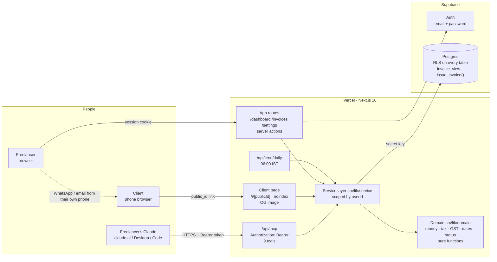

# Architecture

Dues is one Next.js app on Vercel with a Supabase Postgres database. The browser app, the client payment page and Claude's MCP tools all call the **same service layer**, so a rule written once applies to every entry point. There is no AI model inside Dues (the no-AI check runs before every build); the freelancer's own Claude is an external client.

## Diagram

## Shared service layer

- **`src/lib/domain`** holds pure logic with no I/O, unit tested:
  - `money.ts`: rupees to paise parsed from text with BigInt; half-up rounding; lakh grouping.
  - `tax.ts`: CGST/SGST/IGST and the claimed-total check.
  - `gst.ts`: GSTIN and PAN checksums, state codes, Udyam, MSME wording.
  - `dates.ts`: IST, financial years, numbering.
  - `status.ts`: derived status, allowed actions, reminder stages.
  - `upi.ts`
- **`src/lib/service`** holds every read and write. Each function takes a `Ctx { userId, actor }` and scopes every query by `userId`, using the server-only secret key. The actor (`user`, `claude`, `client`, `system`) is written to the `events` table, which is the history shown on each invoice.
- **Three entry points, one rulebook:**
  - server actions (app);
  - `getPublicInvoice` / `reportPaymentPublic` (client page);
  - `registerDuesTools` (MCP).

  The MCP tools import no function that sends, confirms, cancels or deletes. A static test enforces this (D24).
- **The browser never writes to the database directly.** RLS allows reads of the user's own rows only, and `save_draft` and `issue_invoice` are revoked from `anon` and `authenticated`.

## Money and numbering

- **Paise everywhere:** amounts are `bigint` paise in the DB and integers in TypeScript. Input is parsed from text (`"2,500.50"`), never through floats; float noise like `0.1 + 0.2` is refused rather than rounded.
- **Tax:**
  - Computed on the taxable value.
  - CGST and SGST split for the same state, with the odd paisa going to CGST; IGST across states.
  - No GSTIN means no tax and "GST not applicable".
  - Claude may pass the total it expects. More than ₹1 off flags the draft until a person confirms (D30 keeps that confirmation through later saves).
- **Numbering:**
  - `{prefix}/{FY}/{seq}`, at most 16 characters (the GST limit), for example `INV/2026-27/0001`.
  - The number is allocated **only on Send**, inside the `issue_invoice()` Postgres function, in one transaction that also locks the amounts, snapshots the seller and buyer, and creates the public id.
  - `invoice_counters (user_id, fy)` is incremented with `INSERT … ON CONFLICT DO UPDATE … RETURNING` (a row lock), so two concurrent sends can't get the same number and there are no gaps. Drafts never consume a number, and cancelled invoices keep theirs.
  - The FY rolls on 1 April IST.
- **Status is derived:**
  - `invoice_view` computes `paid`, `overdue`, `partially_paid` and so on from the stage, the due date in IST and confirmed payments plus TDS.
  - Status is never stored, so it can't drift.
  - Any migration that adds an `invoices` column must recreate the view (0006).

## Security

- **Accounts:**
  - Supabase Auth with email and password.
  - RLS on every table; the browser has read-only access to its own rows.
  - The service layer runs server-side only.
  - A cap of 50 invoices per account.
  - Delete account cascades every table from `auth.users`.
- **Client links:** `/i/<public_id>` uses 128 random bits, exists only after Send, is `noindex`, and shows only what's on the invoice. Link previews (OG) show the business, number, balance and due date, never client details.
- **The Claude connection (D25, D28):**
  - Each user has one random 192-bit token. **Only its SHA-256 hash is stored**, so a database leak doesn't expose working tokens.
  - The token is shown once on creation or regenerate; after that, only the last 4 characters.
  - **Header only:** Claude sends `Authorization: Bearer <token>` to `https://usedues.vercel.app/api/mcp`. The token never appears in a URL, browser history, referrer or Vercel's request logs.
  - A missing header and an unrecognised token each get their own 401 message, with no `WWW-Authenticate` header (no OAuth yet). `/.well-known/*` returns a JSON 404, and the auth proxy only guards app pages (D32). CORS preflight is answered. The retired `/api/mcp/<token>` format returns 410 with reconnect instructions, and never reads the path.
  - **Kill switch:** Regenerate invalidates the old token immediately. It's disabled on shared demo accounts.
  - **Never logged:** no `src` file logs request headers or `authorization` (a guard test), and verbose MCP logging is off.
  - **v2: OAuth** for sign-in, explicit consent screens, scopes and token expiry. A bearer token has none of these: anyone holding it is the user until it's regenerated.
- **What Claude can't do (D24):** send, number, confirm or reject payments, cancel, delete, or overwrite client contact details. Payments Claude records are saved as `reported` for the freelancer to confirm. Even a prompt-injected Claude can't move money-relevant state.
- **Cron:** `/api/cron/daily` requires `Bearer CRON_SECRET`, compared with `timingSafeEqual`.
- **CSV export:** a UTF-8 BOM, quoted cells, and a leading `'` on cells starting with `= + - @` to block formula injection.

## Trust and fraud (D16, D17)

Dues lets anyone create a professional-looking invoice page, so it could be used for invoice-redirection fraud: an invoice in a real business's name carrying the scammer's bank details. v1's rule is that **the client's page claims nothing Dues can't back up.**
- It never says a business or bank account is "verified".
- It says plainly that Dues doesn't verify them.
- It marks the GSTIN as "structurally valid" (format, checksum, state), with a link to the government's public GST search.
- It warns when the account is less than 30 days old.
- It shows "Bank details updated on {date}" when the bank details changed within 7 days of sending, because redirection scams usually involve a last-minute bank change. The page shows the bank details frozen when the invoice was sent, so a later change can't silently alter an invoice that's already out.

A "Report this invoice" link writes to `abuse_reports` and logs an event. Nothing happens automatically, so the link can't be used to take down a legitimate freelancer.

On the payment side, a client's "I've paid" never changes whether an invoice is overdue. It only pauses chasing for 2 working days. Reused or oddly formatted transaction references are flagged to the freelancer rather than blocked, because real payers often paste the wrong ID.

Real verification (bank "penny drop" name match, GSTIN active status) is v2. It needs a provider whose live keys require business verification (days), and test-mode results would make any badge false. v1 ships the `verifications` table and "Not verified" labels, so enabling it later is a provider sign-up, not a rewrite.

## Out of scope for v1

- **Sending:** Dues sends no email or WhatsApp itself; the freelancer shares from their own phone.
- **Verification:** no payment gateway or automatic payment matching; no bank or GSTIN verification (labels say "Not verified").
- **Invoice types:** no recurring invoices, credit or debit notes, foreign currency, or GSTR-1 export.
- **Teams:** no teammates or roles.
- **Fraud reports:** no ops review queue (reports are logged only).
- **Imports:** no importing past invoices, and no logo on invoices.
- **Claude auth:** no OAuth for Claude.

## Running cost per customer

These are estimates at November 2026 list prices, for an active freelancer sending about 15 invoices a month, with about 60 MCP calls and 300 page views.

| Item | At launch (free tiers) | At 1,000 active customers |
|---|---|---|
| Vercel (functions, bandwidth, cron) | ₹0 (Hobby) | Pro $20/month + usage ≈ ₹4,000/month → **≈ ₹4 per customer** |
| Supabase (Postgres, Auth) | ₹0 (Free: 500 MB) | Pro $25/month; ~2 MB per customer per year fits easily → **≈ ₹2 per customer** |
| Domain and email (v2: transactional email, ~45 per customer per month) | — | ≈ ₹2 per customer |
| AI model cost | **₹0.** The customer's own Claude does the drafting; Dues runs no model. | ₹0 |
| **Total** | **₹0** | **≈ ₹8 per customer per month**, against a ₹299 Pro price (D11) |

The marginal cost is dominated by fixed platform fees, not usage. Verification (₹1–5 per check, D17) is the only per-use cost, and it would be passed through in a paid "Verified business" badge.
