# Dues: user flows, closed-loop analysis

Every flow below is checked for one thing: does every party learn that it's done? A flow is closed when each end state has a screen that says so and a next step (or "nothing left to do"). Dead ends and orphan states found are listed with their fix. **Fixed** means fixed in this build; **v2** means logged for later with the reason.

Parties: **F** = freelancer (Dues app), **C** = Claude (MCP tools), **K** = client (public invoice page), **Cron** = daily job at 06:00 IST.

## Invoice and payment states

Invoice status is derived in SQL (`invoice_view`) from the stage plus payments. Only one status shows at a time, in this order: cancelled, draft, paid, overdue, partially paid, sent. "Payment reported" is a flag shown next to the status, not a status.

```mermaid
stateDiagram-v2
    [*] --> Draft: F creates in app / C create_invoice
    Draft --> Draft: edit (F or C), Claude total flagged → F confirms totals
    Draft --> [*]: F deletes draft
    Draft --> Sent: F presses Send (number + link given here)
    Sent --> PartiallyPaid: confirmed payment < balance
    Sent --> Overdue: due date passes (derived; cron logs it once)
    PartiallyPaid --> Overdue: due date passes
    Overdue --> PartiallyPaid: due date extended past today
    Sent --> Paid: confirmed payments + TDS cover the total
    PartiallyPaid --> Paid
    Overdue --> Paid
    Sent --> Cancelled: F cancels (number stays used)
    PartiallyPaid --> Cancelled
    Overdue --> Cancelled
    Paid --> [*]
    Cancelled --> [*]

    state "Payment report" as R {
        [*] --> Reported: K taps I've paid / C record_payment
        Reported --> Confirmed: F confirms (amount and TDS editable)
        Reported --> Rejected: F rejects, or the invoice is cancelled
    }
```

## Who is notified, where

v1 has no outbound messages: everything is in-app, and the freelancer sends reminders from their own WhatsApp or email. v2 adds email (and later WhatsApp Business) for the rows marked v2.

| Transition | Freelancer | Client | Claude | v1 | v2 |
|---|---|---|---|---|---|
| Claude creates a draft | Dashboard row "Drafted by Claude", within ~8 s (auto-refresh) | — | Tool result with Dues' totals | In-app | — |
| Draft flagged (Claude's total off by > ₹1) | "Check totals" on the row; warning banner on the draft; Send blocked | — | `needs_review` + reason in the tool result | In-app | — |
| Claude marks ready | "Needs you → Send …'s invoice" | — | Tool result | In-app | Email digest |
| Freelancer sends | Toast, link to copy, share panel | Only when F shares the link (WhatsApp / email / copy) | `list_invoices` shows the number | In-app | Dues emails the client |
| Due date passes | Row turns "Overdue · N days late"; "Needs you" chase item with next reminder stage | Client page says "Was due on …" | `get_receivables_summary` | In-app (cron logs `became_overdue` once) | Daily email to F |
| Reminder saved by Claude | Reminder card with WhatsApp / email button | When F taps the button and sends | Tool result with the link | In-app | Scheduled sending |
| Client opens the link | "Viewed N times · last {time}" on the invoice and chase list (D37) | — | `client_views` in `list_invoices` and the summary | In-app | Email / push to F on first open |
| Client reports a payment | "Needs you → … says ₹X was paid", with UTR checks, TDS guess and proof link (D40) | Banner: "Payment reported" | `payment_reported_unconfirmed` flag | In-app | Email / push to F |
| Freelancer confirms | Toast; status updates; "Received this month" | Client page shows the new balance or "Paid in full" | Status in tool results | In-app | Receipt email to K |
| Freelancer rejects | Toast | Banner: "… couldn't find your payment of ₹X" (**Fixed**) | Status in tool results | In-app | Email to K |
| Due date extended | History entry; document shows original and new date | "Moved the due date from … to …" | — | In-app | Email to K |
| Invoice cancelled | Red "Cancelled" banner | "This invoice was cancelled. Please don't pay it." | Status `cancelled` | In-app | Email to K |
| Client reports fraud | Nothing (by design: the reporter may be the victim of someone impersonating F) | "Thanks. We've logged your report." | — | Logged to `abuse_reports` | Ops review queue |

---

## 1. Sign up → onboarding → first invoice

- **Trigger and entry points:** landing page "Create a free account"; the login page link; a client page footer ("Sent with Dues").
- **Steps:**
  1. `/signup`: email and password (show-password toggle).
  2. Step 1 of 4, Business profile.
  3. Step 2, Tax and compliance.
  4. Step 3, Getting paid (optional now: the bank account is asked for at the first Send, D35).
  5. Step 4, Claude connection: create a token and connect.
  6. Dashboard.
- **End states:**
  - **Set up:** the dashboard shows "No invoices yet" with "New invoice" and "Connect Claude".
  - **Incomplete profile:** the user skipped a step or closed the tab.
- **What the user sees:**
  - With an incomplete profile (business name, address or state missing), an amber bar on every app page says "Finish setup before you can send invoices: add your …" and links to Settings.
  - Drafts can still be created by hand or by Claude. Send is disabled with the reason shown, and Claude's send refusal names the missing fields.
- **Errors:**
  - An existing email gets "Log in instead".
  - A password under 8 characters is rejected inline.
  - A sign-up rate limit gets a plain message.
  - Section errors show under each field. Each section saves on its own, so missing bank details don't block saving the business name (D29).
- **How the loop closes:** the setup bar disappears once `setupGaps` is empty. Sending the first invoice gives it 0001.
- **Dead ends found:**
  - Step 4 had no way forward after creating a token. **Fixed:** "Go to your dashboard" button in onboarding mode.
  - The old single 2,700px form made the user scroll past fields they didn't need yet. **Fixed** by the stepped Settings.

## 2. Connect Claude

- **First time:**
  1. Settings → Claude connection → **Create my Claude token**.
  2. The token is shown once, with icon copy buttons for the token and the full header line.
  3. Follow the claude.ai steps: Customize → Connectors → + Add → Add custom connector → URL → No sign in → Request headers `Authorization: Bearer …` → Add. Claude Code users run a one-line command.
  4. Status changes from "Token created · not used yet" to "Connected · last used …" after Claude's first call.
- **Regenerate:** a confirmation dialog explains that the old token stops working at once. The new token is shown once. The old one gets 401 "This Dues token isn't valid. It may have been regenerated…".
- **Lost token:** it can't be shown again (only its hash is stored), so the user regenerates. The screen says this next to the masked `…last4`.
- **Old URL-token connections (before D28):** get 410 "This link format was retired. Reconnect using Settings → Claude connection" rather than failing silently.
- **Demo account:** Regenerate is disabled with the reason ("so the shared demo token keeps working for every reviewer"). Reviewers get the server URL and header value in the submission.
- **Errors:**
  - A missing header gets 401 with the exact fix.
  - If claude.ai has no "Request headers" field on that account, the page says so and points to Claude Code.
- **How the loop closes:** the "last used" time is the freelancer's proof that Claude reached Dues. Claude sees the 9 tools.
- **Dead ends:** none open. A paused or disconnected Claude is invisible to Dues except through "last used". v2 could flag it after seven idle days.

## 3. Claude creates an invoice

- **Trigger:** the freelancer asks Claude in chat.
- **Steps:**
  1. Claude calls `get_business_profile` to read the defaults and reminder tone.
  2. Claude calls `create_invoice`, either with a known client or a new client inline.
  3. Dues computes the totals and returns them.
  4. Claude quotes Dues' figures.
- **End states:**
  - **Clean draft:** it shows on the dashboard with "Drafted by Claude".
  - **Flagged draft:** Claude's `expected_total` was off by more than ₹1. The row says "Check totals"; the draft has a warning banner and "Totals are right". Send is blocked; Claude's `mark_ready_to_send` is refused.
  - **New client without a state:** a `client_state_needed` error asks Claude for the state. No draft is created.
  - **Duplicate retry within 10 minutes with the same items:** the same draft is returned with a note. Claude passes `allow_duplicate` only if the freelancer really wants two.
  - **Not GST registered:** GST is set to 0 with a warning that Claude relays.
- **How the loop closes:**
  - Claude says "draft ready, open it in Dues to send" and links to it.
  - The freelancer sees it within about 8 seconds. Auto-refresh also runs on tab focus.
  - Confirming totals now sticks across later saves (fixed tonight: the flag only returns if the total changes or Claude sends a new claim).
- **Dead ends:** none open.

## 4. Create or edit an invoice in the app

- **Trigger:** "New invoice" in the sidebar or top bar; "New invoice" on a client page (client preset).
- **Steps:**
  1. Pick a client from the searchable dropdown, or choose "+ New client" to open a side panel (name and state required). It comes back selected (D36).
  2. Add lines. Totals update live.
  3. The defaults come from Settings → Invoice defaults: GST rate, due days and notes.
  4. Create draft, then edit and save.
- **End states:** a saved draft, plus a 45-day MSME warning if the due date goes past it for a covered supplier.
- **Errors:**
  - Errors show inline per line ("Line 2: add a rate in rupees").
  - Float noise in an amount is refused with a plain message.
- **How the loop closes:** the draft page says "Save your edits first. Send uses the saved version."
- **Dead ends:** an issue date in the past isn't possible, because Send stamps today (D2). Old unpaid invoices from before Dues can't be brought in. **v2:** "Import an existing invoice", which keeps its own number and date.

## 5. Ready to send → Send → share

- **Trigger:**
  - the dashboard "Needs you → Send …"; or
  - the draft page; or
  - Claude's link.
- **Steps:**
  1. Press Send. It's the one main action in the draft header; Preview and Delete are under More (D34).
  2. A dialog names the client and total: "the amounts are then locked". **First Send with no bank account:** the dialog asks for account name, number and IFSC, saves them to Settings, then sends (D35).
  3. The invoice gets a number and a link.
  4. The header's main action becomes Copy link (icon) + WhatsApp (pre-filled text with the client's phone). Record payment, Extend, Edit notes, View as client, Send by email and Cancel are under More (⋯).
- **End states:** the invoice is sent and its link is live. The link preview shows "Invoice {number} from {business} · ₹X due {date}" plus a generated image. The page stays `noindex`.
- **Errors:**
  - Setup is incomplete, so Send is disabled with the reason. The service refuses too (`setup_incomplete`, `bank_details_required`), so the UI can't be bypassed.
  - The draft is flagged, so Send is disabled until the totals are confirmed.
- **How the loop closes:** Dues never sends anything itself in v1, so the share panel stays at the top of the invoice until it's paid.
- **Dead ends:** no email share. **Fixed:** an Email button (mailto) appears when the client has an email address.

## 6. Client opens the link → pays → reports → freelancer decides

- **Trigger:** the link from WhatsApp or email.
- **Steps:**
  1. The client sees who it's from, the amount, the due date and bank details first (with copy buttons).
  2. If the balance is ₹1,00,000 or less and the freelancer allows it, there's a UPI QR and a pay button.
  3. The client taps **Notify as paid**: amount (pre-filled), UTR, method, and optionally a screenshot or PDF receipt (5 MB, private, D40) → **Send**.
  4. The freelancer sees "Needs you" with the UTR checks (unusual format, reused UTR), a TDS guess and "View proof of payment" if attached, then confirms (amount and TDS editable) or rejects.
  - Every open of the page by a real browser (not the freelancer, not link-preview bots) counts as a view: "Viewed N times · last {time}" on the invoice and chase list, and `client_views` for Claude (D37).
- **End states:**
  - **Reported:** the client sees "Payment reported". Chasing pauses for 2 working days.
  - **Confirmed, full:** the client page says "Paid in full".
  - **Confirmed, partial:** the client page shows "Balance due" and the remaining amount.
  - **Rejected:** previously the client saw the plain invoice again with no explanation (an orphan state). **Fixed:** the client page now says "{business} couldn't find your payment of ₹X yet. Check the reference, or contact them."
  - **Abuse limits:** a fourth pending report is refused with a message.
- **Errors:**
  - The UTR must be 6 to 35 letters or digits.
  - Overpayment is refused.
  - A bad link goes to the branded "This invoice link doesn't work" page, with "don't pay anyone from an invoice you can't open here".
- **How the loop closes:** the freelancer gets a "Needs you" item. The client sees reported, then paid or balance due.

## 7. Payment recorded by the freelancer, or noted via Claude

- **Freelancer:** Record payment (amount, TDS, method, UTR, date). It's saved as confirmed straight away.
- **Claude:** `record_payment` saves it as **reported**, never confirmed (D24). It appears in "Needs you" as "You told Claude ₹X was paid by …" for the freelancer to confirm.
- **Partial payments:** the status becomes Partially paid, or stays Overdue if the due date has passed. The balance shows "of ₹total".
- **TDS:** if a confirmed amount plus TDS covers the total, the invoice is Paid. The TDS guess (10%, 2% or 1% of the taxable value) is pre-filled when the shortfall matches. "TDS this month" shows on the dashboard.
- **How the loop closes:** the payments list shows Confirmed, Waiting for you or Rejected, and the history logs who did what.
- **Dead ends:** none. Form 16A tracking per client is **v2**.

## 8. Overdue → chase list → reminder stages → paid

- **Trigger:** the due date passes. Status is derived instantly, and the cron logs `became_overdue` once.
- **Steps:**
  1. "Needs you" shows "{client} · ₹X · N days late. Next: stage 1 · friendly (3 days), stage 2 · firm (7), stage 3 · final (14). Ask Claude to write it."
  2. Claude reads the tone and channel from the profile, then calls `save_reminder`.
  3. The reminder card has a WhatsApp or email button. Tapping it marks the reminder "opened to send".
- **End states:** the client pays (flow 6), so the item leaves the chase list. Or the freelancer extends the due date (flow 9).
- **Pause rule:** within 2 working days of a client report, the item says chasing is paused.
- **Dead end:** a freelancer without Claude can't create a staged reminder. They can still use the share panel ("Send your client a reminder with the link"), which opens WhatsApp with the link pre-filled. A template reminder in the app is **v2**.
- **Escalation after stage 3** (MSME Samadhaan, GST portal message) is **v2**.

## 9. Due-date extension after send

- **Steps:** Extend due date (later dates only, reason required) → saved.
- **What each side sees:**
  - The document shows "Due date moved from {original} to {new}".
  - The client page says the same.
  - The history logs the reason.
  - Metrics keep the original date (D18).
- **How the loop closes:** the status returns from Overdue if the new date is in the future.
- **Dead ends:** none.

## 10. Cancel an issued invoice

- **Steps:** Cancel invoice → a dialog with an optional reason → cancelled.
- **What happens:**
  - Its number stays used, so there are no gaps.
  - Open client reports are closed as rejected.
  - The client page says "cancelled, please don't pay".
- **How the loop closes:** a red banner on the invoice tells the freelancer to create a new one if needed.
- **Dead ends:** "cancel and reissue" is two steps. A one-click "Duplicate as new draft" is **v2**.

## 11. Delete a draft

- **Steps:** Delete draft → confirm → back to the dashboard, with a toast.
- **What happens:** drafts have no number or link, so nothing outside Dues is affected. Claude's `list_invoices` stops returning it.
- **Dead ends:** none.

## 12. Export CSV

- **Entry points:** the dashboard "Export CSV" (a popover with dates), and Settings → Data and export.
- **What you get:** a file with a byte-order mark for Excel and formula-injection guarding. The default range is from the start of the financial year to today.
- **Errors:** an empty range gives a CSV with headers only.
- **How the loop closes:** the browser downloads `dues-invoices-<from>-to-<to>.csv`.

## 13. Fraud report from the client page

- **Steps:** "Report this invoice" → optional reason → "Thanks. We've logged your report."
- **What happens:** it's stored in `abuse_reports` with the invoice and a time. The freelancer is not told, on purpose: the report may be about someone impersonating them.
- **Orphan state:** nobody reviews reports in v1. **v2:** an ops queue, and automatic suspension after N reports on an account under 30 days old. ARCHITECTURE.md lists this as a known gap.

## 14. Account deletion and sign-out

- **Sign out:** from the sidebar (desktop) or Settings → Account. It goes to the login page.
- **Delete:**
  1. Settings → Account → Delete my account.
  2. A dialog requires typing DELETE.
  3. Every table cascades from `auth.users`.
  4. Client links return the not-found page.
  5. The user is signed out and sent to `/`.
- **Demo accounts:** disabled, with the reason.
- **How the loop closes:** the landing page loads signed out. The old email can sign up again.

## Fixes made from this analysis (smallest first)

1. The onboarding step 4 dead end: "Go to your dashboard" button.
2. Email share button when the client has an email.
3. The client page now explains a rejected payment report.
4. The confirm-totals flag returning on save (from the production walkthrough).
5. A branded 404 and invalid-link page with a safe next step for clients.

## Logged for v2

- Import past invoices.
- In-app reminder templates without Claude.
- Duplicate as new draft.
- An ops review queue for fraud reports.
- Email notifications for every row marked v2 above.
- A "Reset demo data" button. Re-run `npm run seed` instead.
