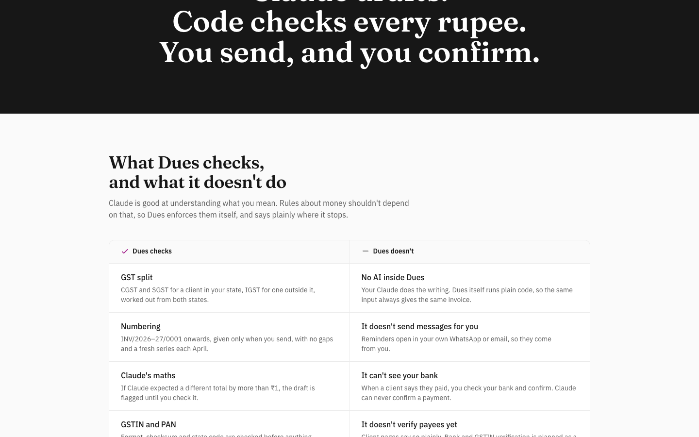
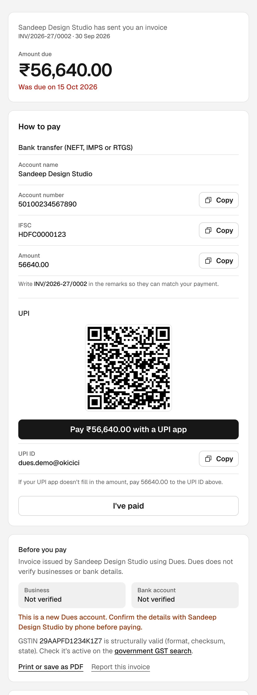

# Dues

**Get paid on time. Correct GST on every invoice.** Make invoices by asking your Claude; Dues checks every number in code.

Dues is a receivables desk for Indian freelancers.
- You tell your own Claude who to bill. Dues creates a GST invoice, computing every rupee, the CGST/SGST or IGST split and the invoice number in code.
- You check it and press Send in the app.
- Your client opens a link, pays by bank transfer or UPI, and taps "I've paid". You confirm it against your bank.
- The dashboard shows who still owes you and when to chase. Claude writes the reminders, and you send them from your own WhatsApp or email.

The rule is **Claude drafts, code checks, a human confirms anything irreversible.** There is no AI model inside Dues. A no-AI check runs before every build.

- **Live:** https://usedues.vercel.app
- **Repo:** https://github.com/netanyaj/dues




## Try it

- **Fastest:** sign up at https://usedues.vercel.app/signup (about 30 seconds), then connect your own Claude as described below.
- **Or** log in with a seeded reviewer account. The credentials are in the submission form. Each account already has invoices in every state: paid with TDS, overdue with reminder stages, partly paid, payment reported, flagged draft, ready to send, cancelled.

## Connect Claude (header auth, D28)

1. In Dues, go to **Settings → Claude connection → Create my Claude token**. It's shown once; copy it.
2. **claude.ai or Claude Desktop:**
   1. Go to **Customize → Connectors → + Add → Add custom connector**.
   2. Name it `Dues` and set the server URL to `https://usedues.vercel.app/api/mcp`. Click **Continue**.
   3. Under **Authentication**, choose **No sign in**.
   4. Under **Request headers**, add the name `Authorization` with the value `Bearer <token>`. Click **Add**.
3. **Claude Code:**

   ```bash
   claude mcp add --transport http dues https://usedues.vercel.app/api/mcp --header "Authorization: Bearer <token>"
   ```
4. In a new chat, try: *"Invoice Acme Corp in Bengaluru, Karnataka for 12 hours of design at ₹2,500/hr with 18% GST, due in 15 days."* The draft appears on your dashboard within seconds.

If your claude.ai account doesn't show **Request headers** (the field is new), use Claude Code. Old `/api/mcp/<token>` links return 410 with reconnect instructions.

**Claude can:**
- read your profile and invoices;
- add clients (it fills blanks and never overwrites);
- create and edit drafts;
- mark a draft ready;
- note a payment for you to confirm;
- save reminders.

**Only you can**, in Dues: send, confirm or reject payments, cancel, delete, or make a new token.

## Docs

| File | What's in it |
|---|---|
| [PRD.md](PRD.md) | Problem, users, scope, stories, UX rules, milestones, risks |
| [DECISIONS.md](DECISIONS.md) | Why each decision was made (D1–D30) |
| [ARCHITECTURE.md](ARCHITECTURE.md) | Diagram, shared service layer, paise and numbering, security, trust and fraud, out of scope, cost per customer |
| [FLOWS.md](FLOWS.md) | Every user flow, end states, notifications, dead ends found and fixed |
| [METRICS.md](METRICS.md) | Activation, % paid by the original due date, days to paid, and how each is computed |
| [TESTING.md](TESTING.md) | Automated checks and the manual checklist with results |

## Stack

- Next.js 16 (App Router, server actions) on Vercel.
- Supabase Postgres and Auth, with RLS on every table.
- MCP over Streamable HTTP with `mcp-handler`.
- Tailwind 4 with a small design system (`src/components/ds.tsx`) and Phosphor icons.
- Vercel Cron runs daily at 06:00 IST.
- Money is integer paise throughout.

## Run locally

1. Install dependencies:

   ```bash
   npm install
   ```
2. Copy the env template and fill in your Supabase keys:

   ```bash
   cp .env.example .env.local
   ```
   You need `NEXT_PUBLIC_SUPABASE_URL`, `NEXT_PUBLIC_SUPABASE_PUBLISHABLE_KEY`, `SUPABASE_SECRET_KEY`, `SUPABASE_DB_URL`, `NEXT_PUBLIC_APP_URL` and `CRON_SECRET`.
3. Apply the migrations in `supabase/migrations`:

   ```bash
   npm run db:push
   ```
4. Start the app at http://localhost:3000:

   ```bash
   npm run dev
   ```

**Tests:**
- Unit tests (domain rules and static guards):

  ```bash
  npm test
  ```
- Database tests (numbering under concurrency, RLS, the cron, confirmed totals):

  ```bash
  npm run test:db
  ```
- 21 MCP checks over HTTP against a running app:

  ```bash
  BASE_URL=http://localhost:3000 npm run test:mcp
  ```
- No-AI check:

  ```bash
  npm run check:no-ai
  ```

**Demo accounts:** `npm run seed -- you@example.com` creates or refreshes an account with sample data. It writes the password, server URL and header value only to `.demo-accounts.local.txt`, which is gitignored and readable only by you.
